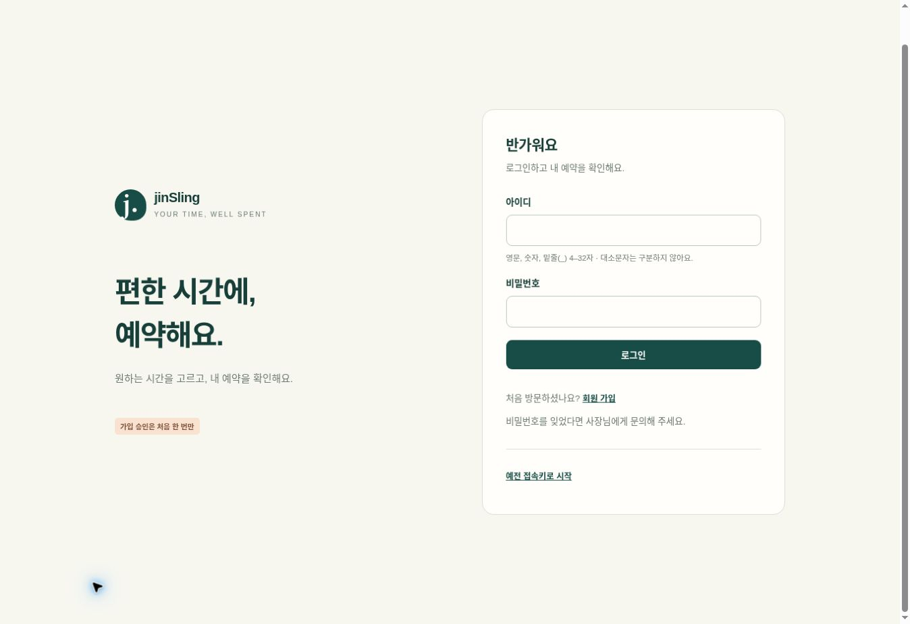
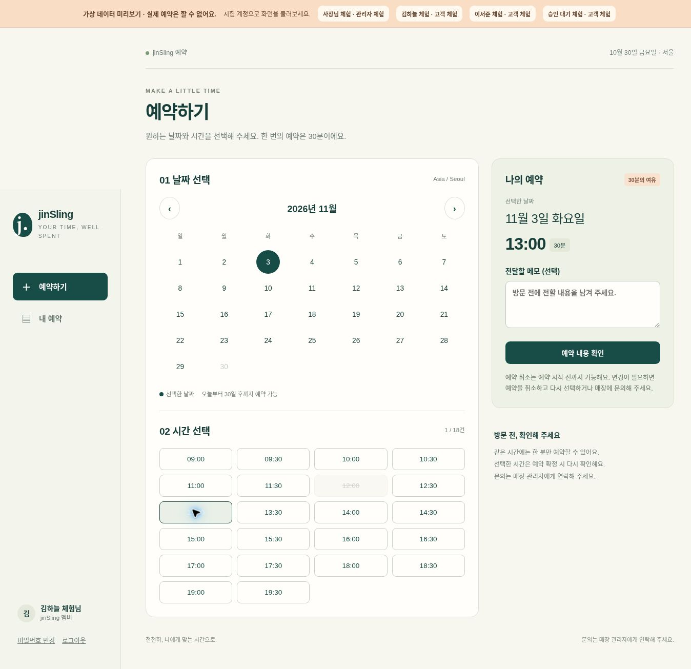
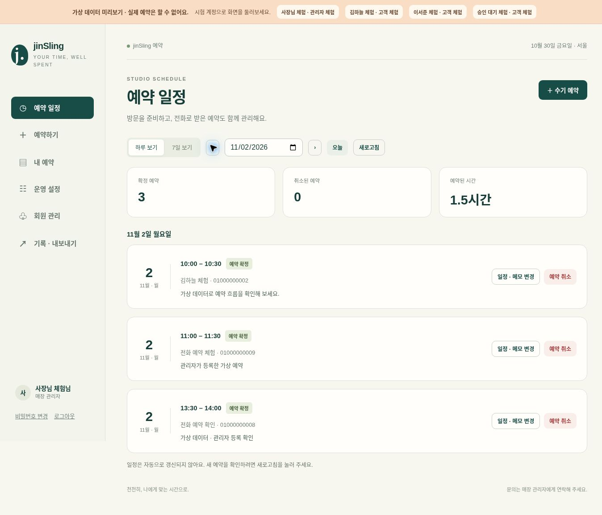

# jinSling

**손님은 편하게 예약하고, 사장님은 한눈에 관리해요.**

1인샵을 위한 작은 예약 앱이에요. 온라인 예약과 전화 예약을 한곳에 모으고, 쉬는 시간도 직접 정할 수 있어요.

> 아래는 가상 데이터로 촬영한 실제 앱 화면이에요. 실제 운영을 위한 계정 연결과 배포는 아직 남아 있어요.

## 화면으로 둘러보기

### 1. 편한 시간에, 예약해요

아이디와 비밀번호로 시작해요. 가입 승인은 처음 한 번만 받으면 돼요.



### 2. 손님은 원하는 시간을 골라요

날짜와 빈 시간을 고르고 예약해요. 내 예약을 확인하거나 취소할 수도 있어요.



### 3. 사장님은 하루 일정을 한눈에 봐요

온라인·전화 예약을 함께 관리해요. 회원을 선택해 예약을 넣거나 일정을 옮길 수 있어요.



## 이런 일을 할 수 있어요

| 손님 | 사장님 |
|---|---|
| 가입 신청과 로그인 | 회원 승인·이용 중지·비밀번호 초기화 |
| 가능한 시간에 예약 | 전화·현장 예약 등록, 예약 이동·취소 |
| 내 예약 확인과 취소 | 휴무·시간 차단, 영업시간과 하루 한도 설정 |
| 내 비밀번호 변경 | 회원·예약 기록을 CSV로 내려받기 |

같은 시간에는 한 분만 예약할 수 있어요. 전화로 받은 예약도 같은 일정에 넣어 중복을 막아요.

## 처음 설정은 이렇게 되어 있어요

| 항목 | 기본값 |
|---|---|
| 예약 시간 | 1회 30분 |
| 월–금 | 09:00–20:00 · 하루 18건 |
| 토요일 | 09:00–14:00 · 하루 10건 |
| 일요일 | 쉬는 날 |
| 회원 등록 | 기본 100명 · 설정상 최대 1,000명 |
| 예약·취소 | 30일 후까지 예약 · 시작 전까지 취소 |

처음에는 4–5명으로 사용해 보세요. 시험 인원과 회원 정원은 별개예요. 등록 한도에는 관리자와 승인 대기·이용 중지·거절 계정도 포함돼요. 영업시간과 하루 한도는 따로 바꿀 수 있고, 점심시간은 사장님이 직접 막아두면 돼요.

## 운영을 준비한다면

운영 중 PC를 계속 켜 둘 필요가 없도록 **Cloudflare Pages·D1 Free + Firebase Authentication Spark**로 구성했어요. 유료 플랜이나 결제수단은 연결하지 않아요. 무료 한도를 넘으면 이용이 제한될 수 있고, 실제 인증 연결과 실행 한도는 배포할 때 확인해야 해요. 1,000명은 앱의 설정 상한이며 처리량 보증은 아니에요.

회원 정보와 운영 계정은 사장님이 소유하고, 개발자는 가상 데이터로 작업하는 방식이에요. 비밀번호는 사장님 화면이나 CSV에 표시하지 않아요.

- [무료 배포 따라 하기](docs/DEPLOY_FREE.md)
- [사장님 사용 안내](docs/OWNER_GUIDE.md)
- [회원 정보와 Google Sheets 사용](docs/OWNER_DATA.md)
- [앞으로 AI 예약을 붙인다면](docs/AI_EXTENSION.md)
- [지금까지 확인한 내용과 남은 단계](docs/VERIFICATION.md)

## 개발용으로 실행하기

새 웹앱은 `web/`에 있어요. 기존 Python 시제품도 함께 보관하고 있어요. Node.js 24 이상에서 실행해 주세요.

```sh
npm test
npm run build
npm run dev
```

`npm run dev`는 가상 계정과 데이터로 둘러보는 개발 미리보기예요. 실제 매장 서버로 사용하지 않아요.

개발 문서: [웹앱 구성](web/README.md) · [API](docs/API_CONTRACT.md) · [계정 설계](docs/superpowers/specs/2026-10-30-owner-accounts-design.md)
