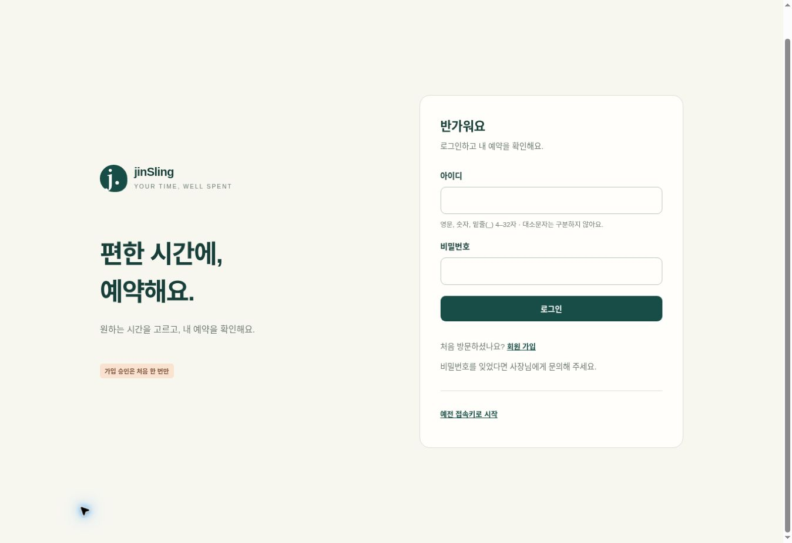
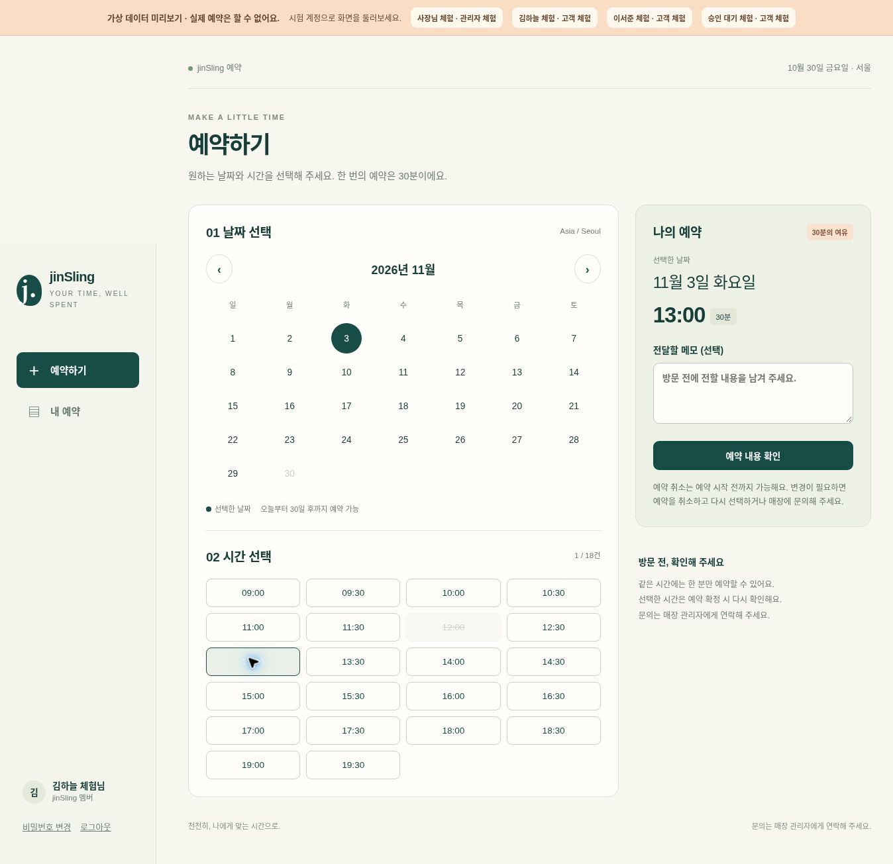
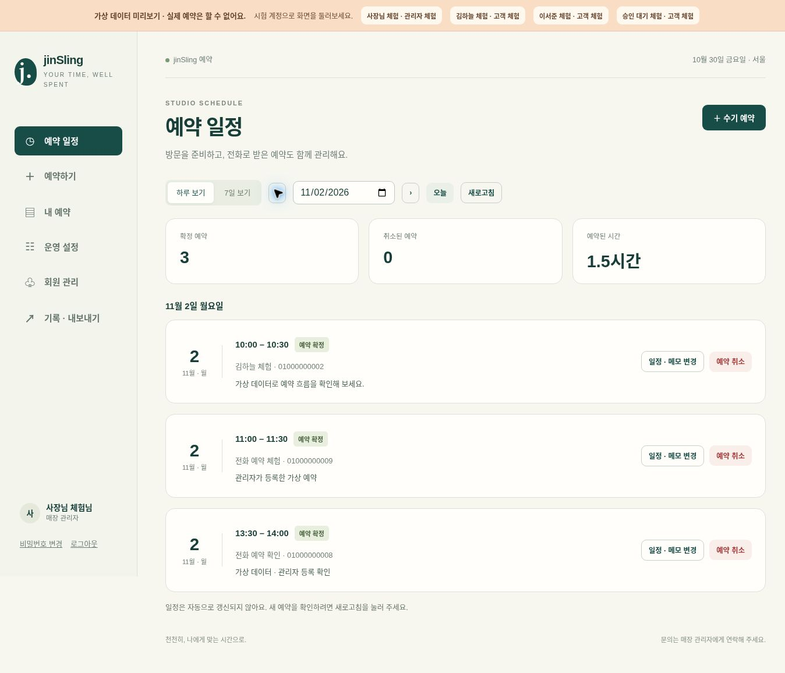

# JINSling

**손님은 편하게 예약하고, 사장님은 한눈에 관리해요.**

1인샵을 위한 작은 예약 앱이에요. 온라인 예약과 전화 예약을 한곳에 모으고, 쉬는 시간도 직접 정할 수 있어요.

> 아래 화면은 가상 데이터로 촬영했어요. 운영 앱은 `web/`, 독립 AI 실험 프로젝트는 `ai-lab/`에 있어요.

## 화면으로 둘러보기

### 1. 편한 시간에, 예약해요

아이디와 비밀번호로 시작해요. 가입 승인은 처음 한 번만 받으면 돼요.



### 2. 손님은 원하는 시간을 골라요

날짜와 빈 시간을 고르고 예약해요. 내 예약을 확인하거나 취소할 수도 있어요.



### 3. 사장님은 하루 일정을 한눈에 봐요

온라인·전화 예약을 함께 관리해요. 회원을 선택해 예약을 넣거나 일정을 옮길 수 있어요.



## 이런 일을 할 수 있어요

| 손님 | 사장님 |
|---|---|
| 가입 신청과 로그인 | 회원 승인·이용 중지·비밀번호 초기화 |
| 가능한 시간에 예약 | 전화·현장 예약 등록, 예약 이동·취소 |
| 내 예약 확인과 취소 | 하루·반나절·기간 잠금, 매일·매주·격주·매달 반복 잠금 |
| 내 비밀번호 변경 | 회원·예약 기록을 CSV로 내려받기 |
| 앱 안의 회원 이용 가이드 | 앱 안의 사장님 이용 가이드 |

같은 시간에는 한 분만 예약할 수 있어요. 전화로 받은 예약도 같은 일정에 넣어 중복을 막아요.

## 처음 설정은 이렇게 되어 있어요

| 항목 | 기본값 |
|---|---|
| 예약 시간 | 1회 30분 |
| 월–금 | 09:00–20:00 · 하루 18건 |
| 토요일 | 09:00–14:00 · 하루 10건 |
| 일요일 | 쉬는 날 |
| 회원 등록 | 기본 100명 · 설정상 최대 1,000명 |
| 예약·취소 | 30일 후까지 예약 · 시작 전까지 취소 |

처음에는 4–5명으로 사용해 보세요. 시험 인원과 회원 정원은 별개예요. 등록 한도에는 관리자와 승인 대기·이용 중지·거절 계정도 포함돼요. 영업시간과 하루 한도는 따로 바꿀 수 있어요. 점심시간은 **운영 설정 → 반복 잠금 → 점심시간 설정**에서 월~토 13:00–14:00으로 한 번 등록하면 계속 적용돼요.

반복 잠금은 요일과 시간, 시작일과 종료일을 정할 수 있어요. 격주는 시작일이 속한 주부터 한 주씩 건너뛰고, 매달 특정 날짜나 둘째 월요일 같은 일정도 설정해요. 필요한 날만 예외로 열거나 전체 반복을 잠시 쉬게 할 수도 있어요. 기존 예약과 겹치는 설정은 저장 전에 알려 주며, 예약을 자동 취소하지 않아요.

## 운영을 준비한다면

운영 중 PC를 계속 켜 둘 필요가 없도록 **Cloudflare Pages·D1 Free + Firebase Authentication Spark**로 구성했어요. 유료 플랜이나 결제수단은 연결하지 않아요. 무료 한도를 넘으면 이용이 제한될 수 있고, 실제 인증 연결과 실행 한도는 배포할 때 확인해야 해요. 1,000명은 앱의 설정 상한이며 처리량 보증은 아니에요.

사장님은 앱에서 회원 승인과 일정을 관리하고, 개발자는 배포·업데이트를 맡아요. 개발자의 클라우드 관리 권한이 자동으로 사라지는 구조는 아니에요. 개발·실험에는 가상 데이터를 사용하고, 비밀번호는 사장님 화면이나 CSV에 표시하지 않아요.

- [무료 배포 따라 하기](docs/DEPLOY_FREE.md)
- [사장님 사용 안내](docs/OWNER_GUIDE.md)
- [회원 사용 안내](docs/MEMBER_GUIDE.md)
- [회원 정보와 Google Sheets 사용](docs/OWNER_DATA.md)
- [별도 AI 실험 프로젝트](ai-lab/README.md)
- [운영 앱과 AI의 연결 계획](docs/AI_EXTENSION.md)
- [지금까지 확인한 내용과 남은 단계](docs/VERIFICATION.md)

## 개발용으로 실행하기

새 웹앱은 `web/`에 있어요. 기존 Python 시제품도 함께 보관하고 있어요. Node.js 24 이상에서 실행해 주세요.

```sh
npm test
npm run build
npm run dev
```

`npm run dev`는 가상 계정과 데이터로 둘러보는 개발 미리보기예요. 실제 매장 서버로 사용하지 않아요.

AI 실험실은 `cd ai-lab` 후 자체 `npm ci`, `npm test`, `npm run dev`로 실행해요. 운영 앱의 빌드에 포함되지 않으며, 기본 모의 대화와 실제 Workers AI 연결 모드를 구별해요. 실제 모델은 무료 요금제와 별도 AI binding을 확인한 뒤 켜요.

개발 문서: [웹앱 구성](web/README.md) · [API](docs/API_CONTRACT.md) · [계정 설계](docs/superpowers/specs/2026-10-30-owner-accounts-design.md)
